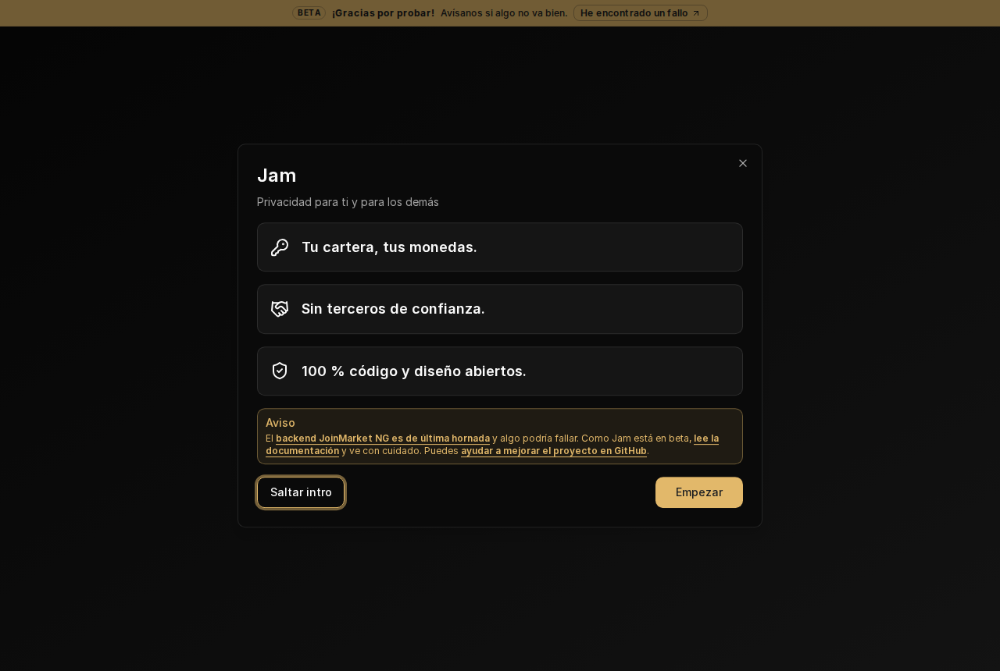
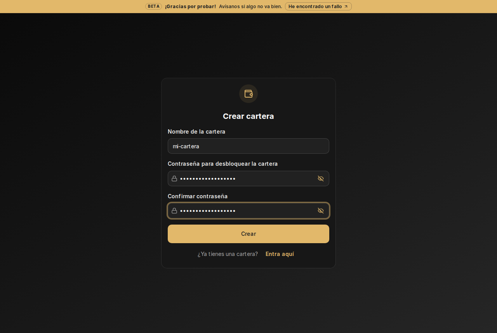
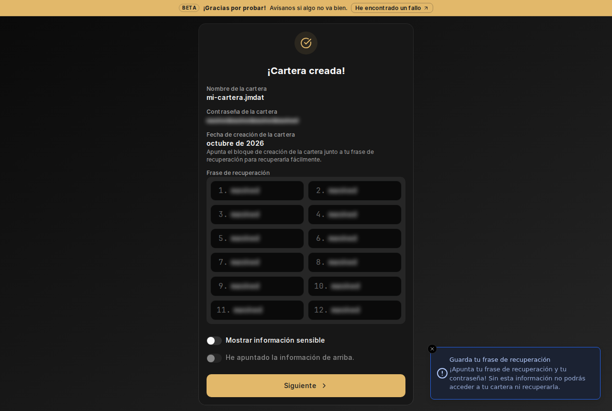
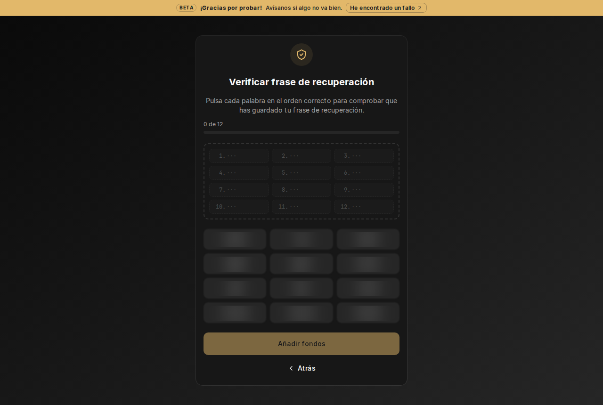
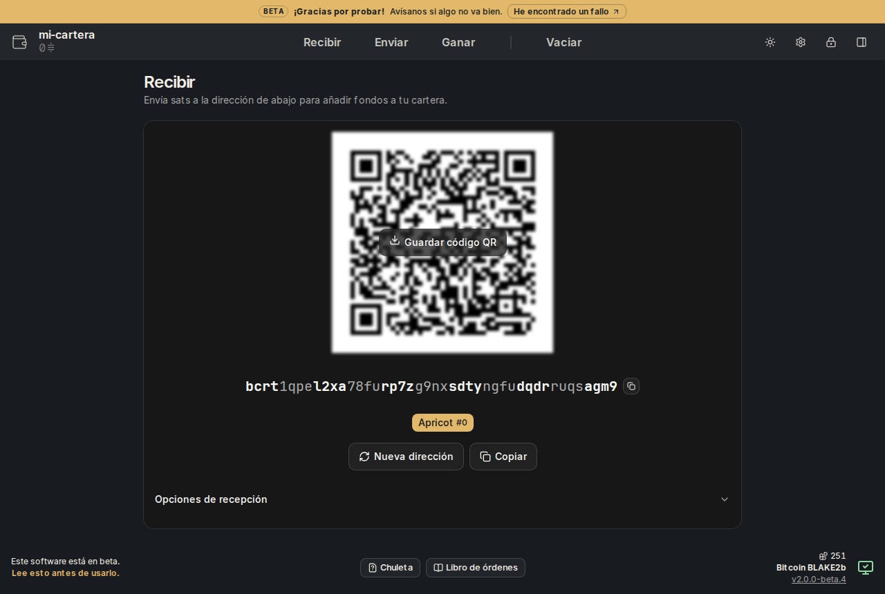
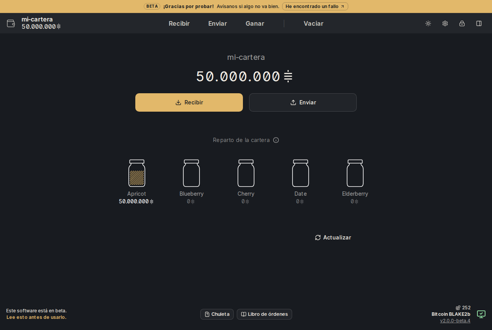
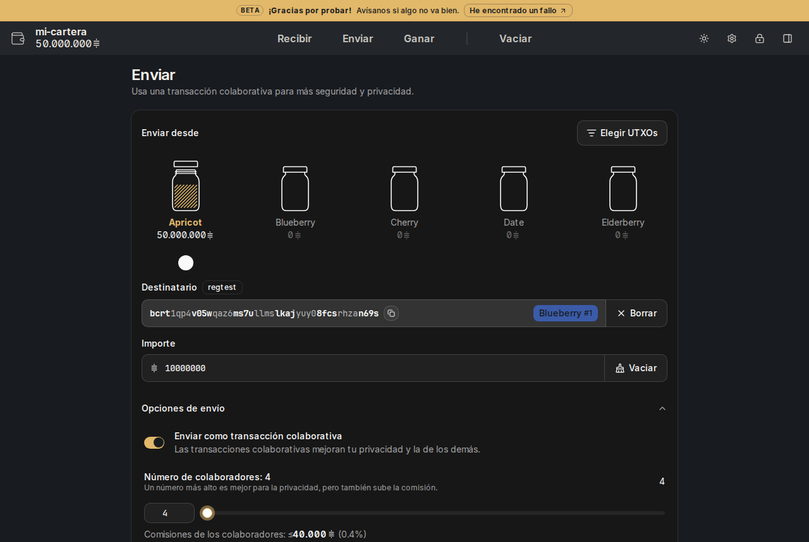
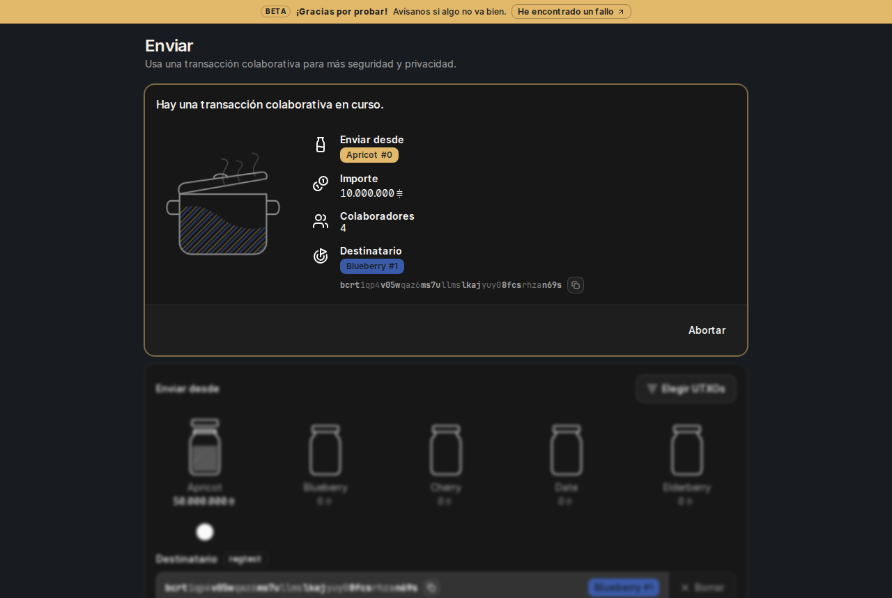

# Jam XBT en Linux: CoinJoin en Bitcoin BLAKE2b

Jam es una cartera con interfaz web para hacer CoinJoin (mezclar tus monedas
con las de otros para ganar privacidad). Esta versión solo funciona en
Bitcoin BLAKE2b (XBT).

## Qué necesitas

- Un ordenador con Linux y **Docker** instalado.
- Tu nodo **Bitcoin Knots BLAKE2b** (node-bip110) en el mismo ordenador,
  **sincronizado**, con usuario y contraseña RPC y la cartera activada (sin
  `disablewallet=1`).

## 1. Consigue la imagen

**Opción A: descargarla.**

```sh
docker pull ghcr.io/kilombino/jam-xbt:0.41.0-xbt3
docker image inspect --format '{{index .RepoDigests 0}}' ghcr.io/kilombino/jam-xbt:0.41.0-xbt3
```

La segunda línea muestra un `sha256:…`. Tiene que ser **igual** a este:

```
sha256:e16139b50d14068d32d14af1c0d2b20358b16359786224ac62e252cfda87b69a
```

Si no coincide, no sigas.

**Opción B: compilarla tú.** Necesitas `git`.

```sh
git clone -b v0.41.0-xbt3 https://github.com/Kilombino/joinmarket-ng.git
git clone -b v2.0.0-beta.4-xbt3 https://github.com/Kilombino/jam.git jam-xbt
cd joinmarket-ng
JAM_REF=v2.0.0-beta.4-xbt3 xbt-docker/build.sh ../jam-xbt
```

Con los mismos commits sale la misma imagen, bit a bit (ver `XBT.md`,
"Reproducible image").

## 2. Deja que Jam hable con tu nodo

Jam va dentro de una "caja" (un contenedor) con su propia red. Desde dentro,
tu ordenador se llama `host.docker.internal` y tiene la dirección
`172.17.0.1`. Tu nodo tiene que escuchar también ahí.

Añade estas cuatro líneas al `bitcoin.conf` de tu nodo y reinícialo:

```
rpcbind=127.0.0.1
rpcbind=172.17.0.1
rpcallowip=127.0.0.1
rpcallowip=172.16.0.0/12
```

(Son direcciones privadas de Docker: nadie de fuera de tu ordenador entra
por ahí. Si tienes cortafuegos, deja pasar `172.16.0.0/12` al puerto 8332.)

## 3. Arranca

Cambia `TU_USUARIO` y `TU_CONTRASEÑA` por los datos RPC de tu nodo y pega:

```sh
docker run -d --name jam-xbt --restart always \
  -p 127.0.0.1:28183:28183 \
  --add-host host.docker.internal:host-gateway \
  -v jam-xbt-datos:/data \
  -e BITCOIN_RPC_URL=http://host.docker.internal:8332 \
  -e BITCOIN_RPC_USER=TU_USUARIO \
  -e BITCOIN_RPC_PASS=TU_CONTRASEÑA \
  ghcr.io/kilombino/jam-xbt:0.41.0-xbt3
```

**No uses `--network host`**: así solo sale de la caja la página de Jam, y
solo para este ordenador (`127.0.0.1`). Tor y lo demás se quedan dentro.

Comprueba que ha arrancado:

```sh
docker logs jam-xbt | grep preflight
```

Debe decir `preflight: XBT node OK`. Si dice `REFUSING TO START`, tu nodo
no es Bitcoin BLAKE2b o no es mainnet: Jam no arranca para proteger tus
monedas. Si dice `waiting for node`, revisa el paso 2 (y que el nodo se
haya reiniciado después de Docker: si arrancó antes, no ve `172.17.0.1`).

## 4. Abre Jam

En el navegador del mismo ordenador: **<https://localhost:28183>**

La primera vez el navegador avisa del certificado (es propio, no de una
empresa). Pulsa **Avanzado → Aceptar el riesgo y continuar**.

Si tu navegador está en español, Jam sale en español. Si no, cámbialo con el
icono de idioma o en **Ajustes → Idioma**. Abajo a la derecha debe poner
**Bitcoin BLAKE2b**.



## 5. Crea tu cartera

1. **Crear cartera nueva** → elige un nombre y una contraseña → **Crear**.

   

2. Activa **Mostrar información sensible** y **apunta en papel las 12
   palabras** y la fecha de creación. Sin ellas, si se rompe el ordenador,
   pierdes los fondos. No les hagas foto.

   

3. Marca **He apuntado la información de arriba** → **Siguiente** y pulsa las
   palabras en orden para confirmar.

   

## 6. Recibe

**Recibir → Mostrar dirección** y envía XBT a esa dirección (empieza por
`bc1`). Tu cartera tiene 5 **botes**; lo que recibes entra en el primero.





## 7. Mezcla (enviar con CoinJoin)

Las monedas necesitan **5 confirmaciones** antes de poder mezclarlas.

1. **Enviar** → elige el bote de origen.
2. En **Destinatario** pega una dirección, o pulsa **Elegir bote** para
   mezclar hacia otro bote tuyo.
3. Escribe el **importe** y deja activado **Enviar como transacción
   colaborativa**. Mínimo 4 colaboradores.
4. **Enviar → Confirmar**. Tarda unos minutos; no cierres Jam.

Jam solo mezcla con quien tiene **bono de fidelidad** (ver paso 8). Si no
hay al menos 4, no envía nada y en **Logs** (abajo) verás
`Not enough makers with a fidelity bond`: prueba más tarde.





Cuantas más vueltas des (de bote en bote), más privacidad.

## 8. Gana (prestar liquidez): necesitas un bono de fidelidad

En XBT los demás **solo eligen a quien tiene un bono de fidelidad**. Sin
bono, tu oferta nunca se acepta (Jam te lo avisa en **Ganar**).

Un bono es un depósito que **bloquea tus monedas hasta una fecha que tú
eliges** (siempre el día 1 de un mes). Antes de esa fecha **no se pueden
mover**, pase lo que pase. Cuanto más metas y más tiempo, más te eligen.

1. **Ganar → Crear bono de fidelidad**.
2. Elige la **fecha de desbloqueo** (la más cercana posible es el día 1 del
   mes que viene).
3. Elige el **bote** y las monedas que van al bono. Jam congela las demás
   del bote para no mezclarlas.
4. Revisa, marca **He revisado bien los datos** y confirma. Espera a que la
   transacción tenga confirmaciones.
5. **Ganar → Iniciar**. Deja la oferta **gratis** y Jam encendido.

Cuando llegue la fecha, en **Ganar** podrás **desbloquear** el bono (mover
las monedas a un bote) o **renovarlo**.

Los bonos se crean con la cartera de Jam (firma 0x21, como todo).
**Bonos desde una cartera hardware o almacenamiento en frío: por ahora no.**

## Parar, actualizar y copia de seguridad

- Parar: `docker stop jam-xbt`. Volver a arrancar: `docker start jam-xbt`.
- Tus carteras están en el volumen `jam-xbt-datos`. Copia de seguridad:
  ```sh
  docker run --rm -v jam-xbt-datos:/data -v "$PWD":/copia debian:stable-slim \
    tar czf /copia/jam-xbt-copia.tgz -C /data --exclude=./tor --exclude=./ssl .
  ```
  Aun así, lo importante son **las 12 palabras en papel**.
- Actualizar: descarga la imagen nueva, comprueba su `sha256`, y luego
  `docker rm -f jam-xbt` y repite el paso 3 (tus datos no se borran).

## Seguridad

- Usa una **frase nueva**, creada en Jam. Nunca una que hayas usado en el
  Bitcoin "de siempre" (SHA-256).
- **Nunca importes** en Jam una cartera de la cadena SHA-256.
- Mete **cantidades pequeñas** mientras el mercado es joven.
- El nodo tiene que ser **Bitcoin Knots BLAKE2b**; Jam se niega a arrancar
  con cualquier otro.
- Todas las firmas usan **0x21**: así tus transacciones no se pueden
  repetir en la cadena SHA-256.
- El directorio XBT es
  `f3tfzgk5ilwfapx427yx5ckeh7ptuvskfxnfnicfo747jyq5mgzdtvad.onion:5222`
  (por Tor, dentro del contenedor).
- Jam solo escucha en este ordenador (`127.0.0.1`). No abras el puerto 28183
  a Internet ni arranques el contenedor con `--network host`.
- Jam solo habla con directorios que demuestran quiénes son (autenticación
  de nick verificada).

¿Algo falla? <https://github.com/Kilombino/joinmarket-ng/issues>
